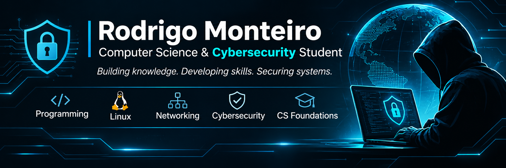

👨‍💻 About Me

I am pursuing a structured 24-month educational journey in Computer Science and Cybersecurity.

My objective is to develop strong theoretical foundations and practical skills in programming, operating systems, computer networks and information security.

I believe in continuous learning, disciplined practice and technical knowledge supported by real-world projects.

🎯 Current Learning Path

Programming

- Python Programming
- Programming Logic
- Algorithms and Problem Solving

Operating Systems

- Linux Fundamentals
- Command-Line Administration
- System Security

Computer Networks

- TCP/IP Fundamentals
- DNS and Network Protocols
- Network Architecture

Cybersecurity

- Information Security Fundamentals
- Security Principles
- Defensive and Offensive Security Fundamentals

Mathematics and Computer Science

- Discrete Mathematics
- Computational Logic
- Computer Science Foundations

🛠️ Technologies & Tools

The following technologies are part of my current learning and practical development:

Technology| Current Status
Python| Learning
Linux| Learning
Git| In Practice
GitHub| In Practice
Termux| In Practice

🔬 Practical Development

I document my technical development through:

- Programming exercises and projects.
- Linux administration laboratories.
- Computer networking exercises.
- Cybersecurity practical laboratories.
- Technical documentation.
- Academic assessments and performance reviews.
- Security research in authorized environments.

🎓 Main Educational Project

24-Month Computer Science & Cybersecurity Formation

From Foundations to Advanced Practical Skills

My main educational project is a structured 24-month program designed to build comprehensive knowledge in Computer Science and Cybersecurity.

"Explore the Cybersecurity Formation Repository" (https://github.com/rodrigomonteiro-exe/cybersecurity)

The program covers:

- Computer Science foundations.
- Programming and software development.
- Mathematics and computational logic.
- Linux and operating systems.
- Computer networks and communication protocols.
- Information security.
- Defensive and offensive security.
- Advanced cybersecurity specializations.

The repository contains academic planning, weekly lessons, practical exercises, assessments, laboratories, projects, technical reports, bibliography and certification guidance.

📈 Learning Philosophy

My development is based on three principles:

1. Consistency: maintaining a structured learning routine.
2. Practice: applying theoretical knowledge through practical exercises and projects.
3. Documentation: recording technical progress and demonstrating acquired competencies through evidence.

My goal is not simply to complete courses, but to develop the ability to understand, build, analyze and secure technological systems.

🌎 Languages

- Portuguese — Native
- English — Intermediate (continuously improving technical English)

🔗 Professional Connections

- "LinkedIn" (https://www.linkedin.com/in/rodrigo-monteiro-230979405/)
- "GitHub" (https://github.com/rodrigomonteiro-exe)
- "Cybersecurity Formation Repository" (https://github.com/rodrigomonteiro-exe/cybersecurity)

---

Learning by building. Securing by understanding.
